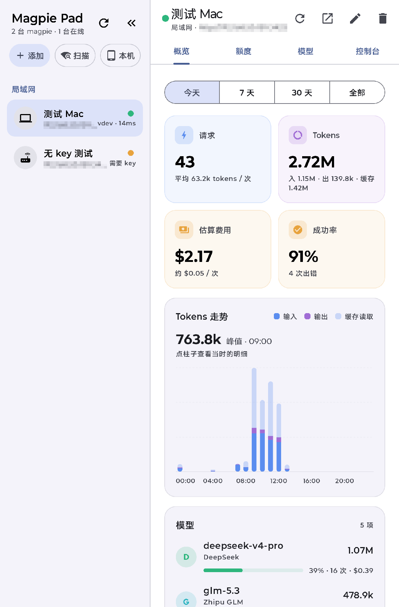
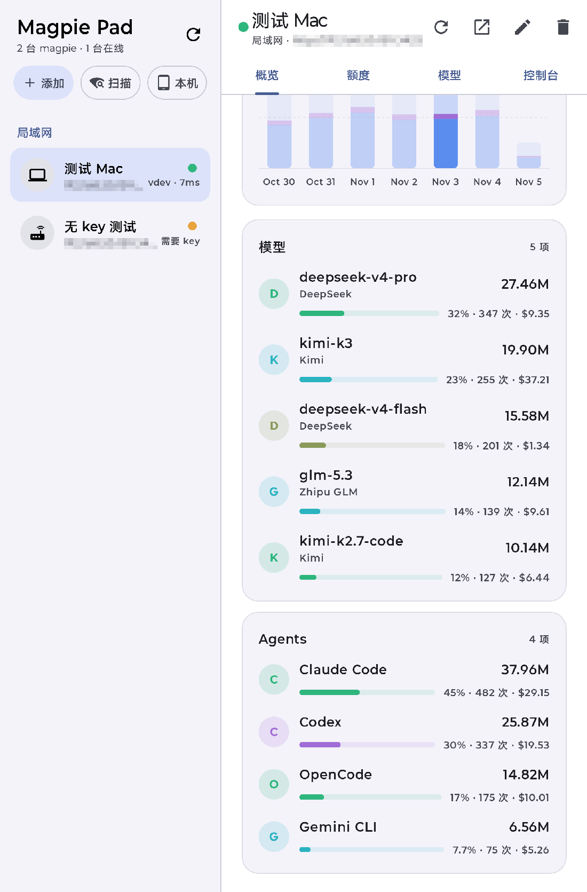
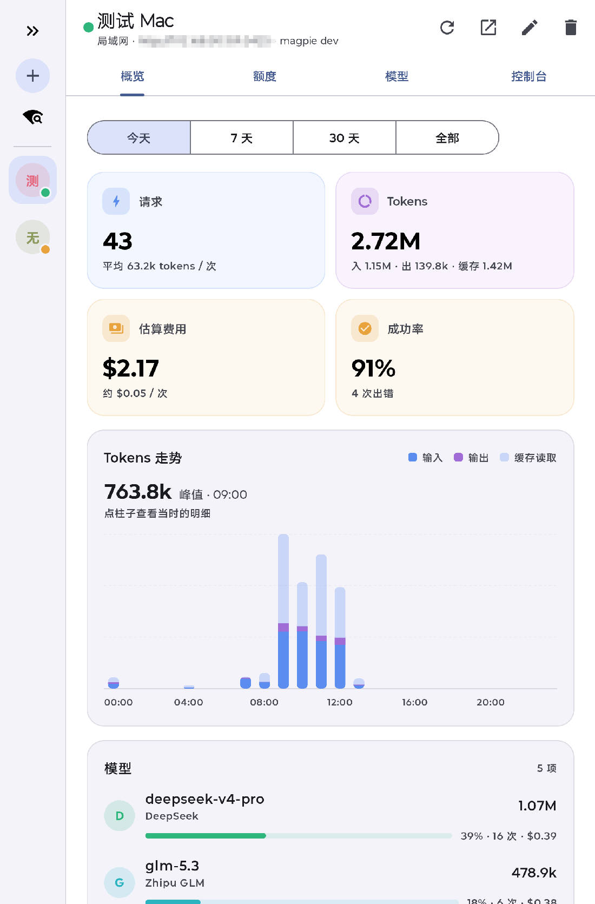
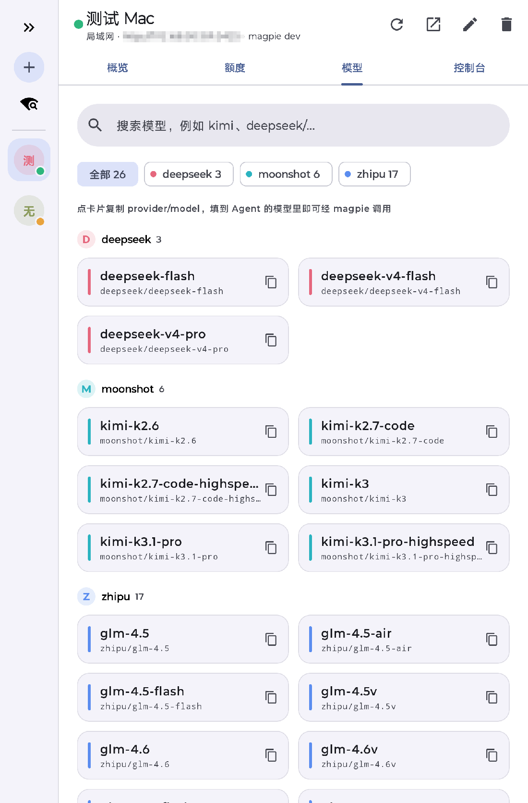
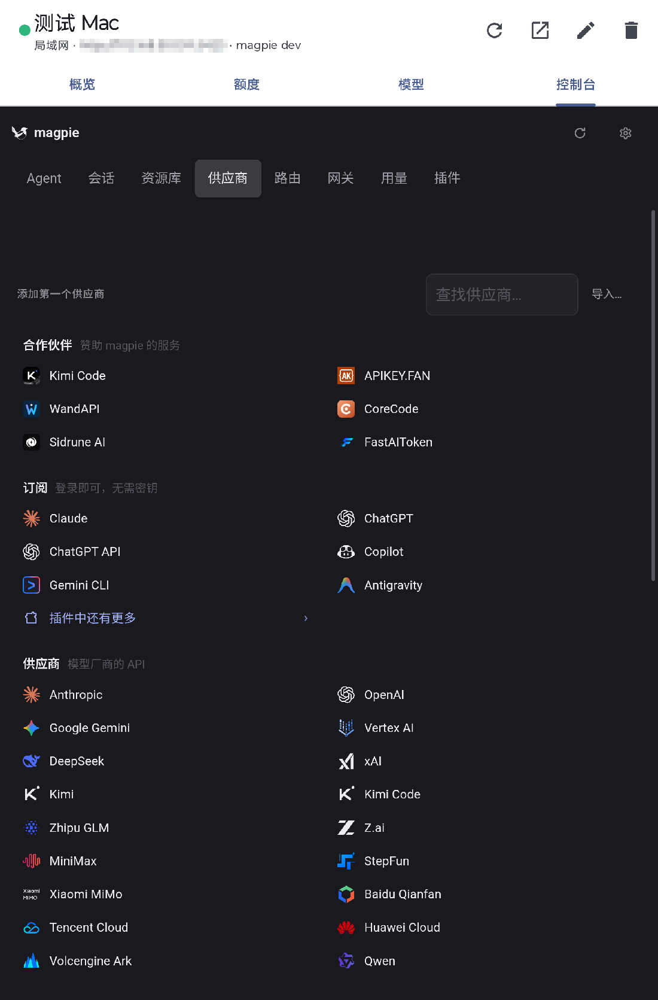

# Magpie Pad

连接和管理本地、局域网、远程 [magpie](https://github.com/yetone/magpie) 的 Android 平板应用（Kotlin + Jetpack Compose）。

## 功能

- 管理多台 magpie：按本机 / 局域网 / 远程分组，每 15 秒检测在线状态和延迟
- 局域网扫描：自动发现同网段开放 3425 端口的 magpie
- 概览：请求数、Tokens、估算费用、成功率，Tokens 走势图，模型 / Agent / 账号排行
- 额度：订阅、套餐和余额的剩余情况，支持向供应商重新读取
- 模型：搜索、按 provider 筛选，点卡片复制 `provider/model`
- 控制台：内嵌 magpie 自带的完整 Web 界面
- 本机运行：通过 Termux 在平板上启动和停止 magpie
- 侧边栏可收起成窄栏，横屏竖屏都能用

## 截图

截图里的用量是测试数据，地址已打码。

概览：



用量排行：



侧边栏收起：



模型：



控制台：



## 安装

从 [Releases](../../releases) 下载 APK 安装，要求 Android 8.0 及以上。

## 连接 magpie

**同一网络或远程的 magpie**：点「添加」填写网关地址（默认端口 3425）。从其他设备访问时需要填网关 key。

**控制台**：在那台机器上运行下面的命令，然后把它打印的链接粘贴到「编辑 → 控制台链接」：

```bash
magpie web --lan --no-open
```

远程服务器建议放在 Tailscale 或 HTTPS 反向代理后面，应用允许明文 HTTP 是为了连接局域网地址。

**平板本机**：先在 Termux 里安装 magpie，并在 `~/.termux/termux.properties` 中设置 `allow-external-apps=true`，然后在应用里点「本机」按提示操作。

## 构建

需要 JDK 17 和 Android SDK 36。

```bash
./gradlew :app:assembleDebug
adb install -r app/build/outputs/apk/debug/app-debug.apk
```

推送 `v*` 标签后，GitHub Actions 会自动打包 APK 并发布到 Release。

## 许可证

代码采用 [MIT](LICENSE) 许可证。应用图标来自 [magpie](https://github.com/yetone/magpie)（MIT，Copyright (c) 2026 yetone）。
